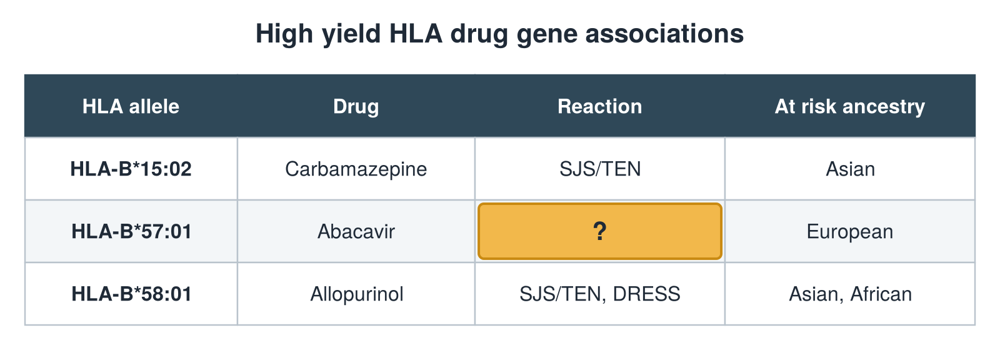

---
id    = "01d91462-040a-4c28-8bef-f60b05724361"
model = "Basic"
tags  = ["phmd205c", "allergy-hla"]
---

## Front

HLA drug gene table: what is hidden?

## Back

Reaction Hypersensitivity

## Extra

Original diagram made for this deck.

Source: PHMD 205C, Allergy and Human Leukocyte Antigen.
