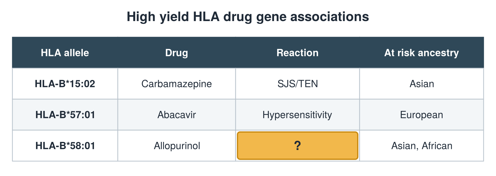

---
id    = "157daa13-3ceb-487b-b9a9-a1e81f3ff301"
model = "Basic"
tags  = ["phmd205c", "allergy-hla"]
---

## Front

HLA drug gene table: what is hidden?

## Back

Reaction SJS/TEN, DRESS

## Extra

Original diagram made for this deck.

Source: PHMD 205C, Allergy and Human Leukocyte Antigen.
