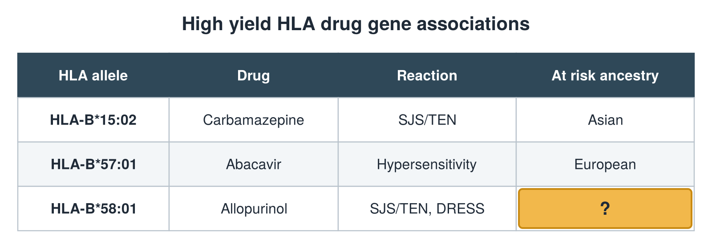

---
id    = "5663d29b-0aa6-4a3c-bad8-02f99fd48ef1"
model = "Basic"
tags  = ["phmd205c", "allergy-hla"]
---

## Front

HLA drug gene table: what is hidden?

## Back

At risk ancestry Asian, African

## Extra

Original diagram made for this deck.

Source: PHMD 205C, Allergy and Human Leukocyte Antigen.
