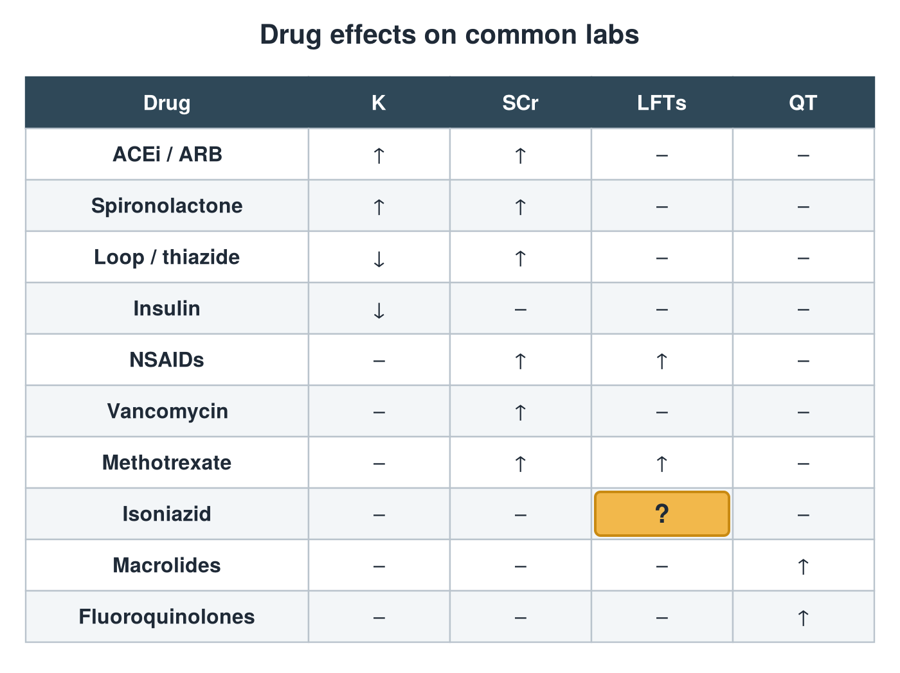

---
id    = "d0416d7c-d17e-474c-ab1c-cfac40ca6498"
model = "Basic"
tags  = ["phmd205c", "drug-induced-labs"]
---

## Front

Drug effects on labs: what is hidden?

## Back

LFTs ↑

## Extra

Original diagram made for this deck.

Source: PHMD 205C, Key Considerations: Medication Related Lab Abnormalities.
