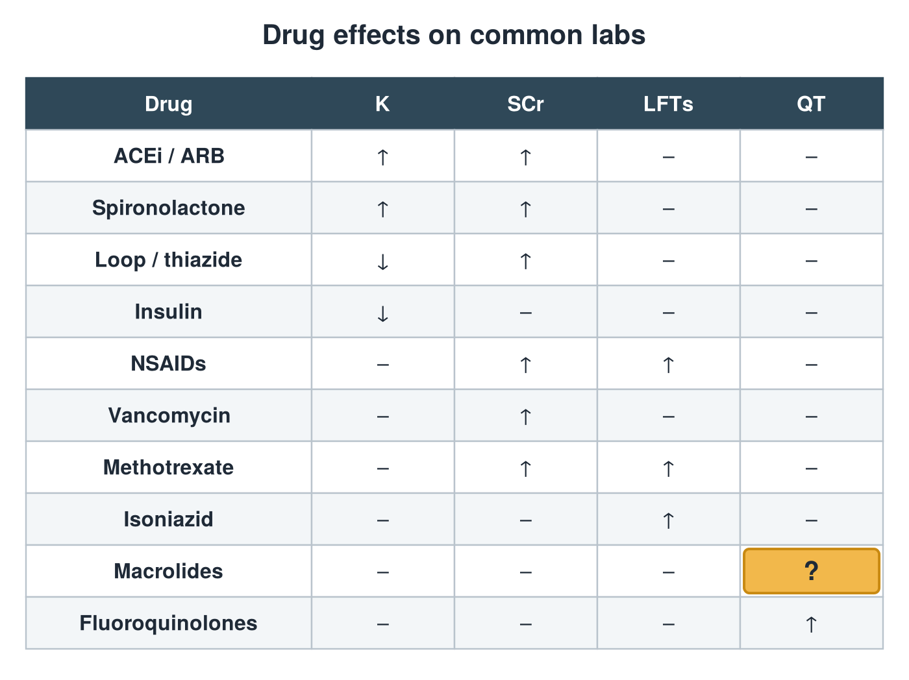

---
id    = "0c893d20-ee1b-41a3-a775-2c07286e3f26"
model = "Basic"
tags  = ["phmd205c", "drug-induced-labs"]
---

## Front

Drug effects on labs: what is hidden?

## Back

QT ↑

## Extra

Original diagram made for this deck.

Source: PHMD 205C, Key Considerations: Medication Related Lab Abnormalities.
