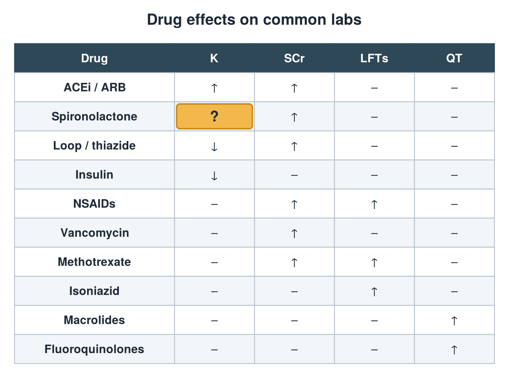

---
id    = "ef982a90-3ed1-4ff6-a1bc-4f46d1493029"
model = "Basic"
tags  = ["phmd205c", "drug-induced-labs"]
---

## Front

Drug effects on labs: what is hidden?

## Back

K ↑

## Extra

Original diagram made for this deck.

Source: PHMD 205C, Key Considerations: Medication Related Lab Abnormalities.
