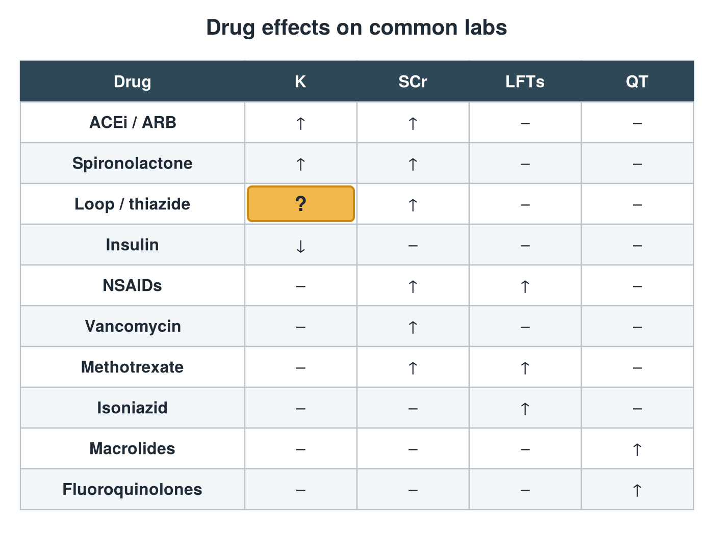

---
id    = "f1d7886c-d55d-4d81-aabb-9cf4c7cfc87f"
model = "Basic"
tags  = ["phmd205c", "drug-induced-labs"]
---

## Front

Drug effects on labs: what is hidden?

## Back

K ↓

## Extra

Original diagram made for this deck.

Source: PHMD 205C, Key Considerations: Medication Related Lab Abnormalities.
