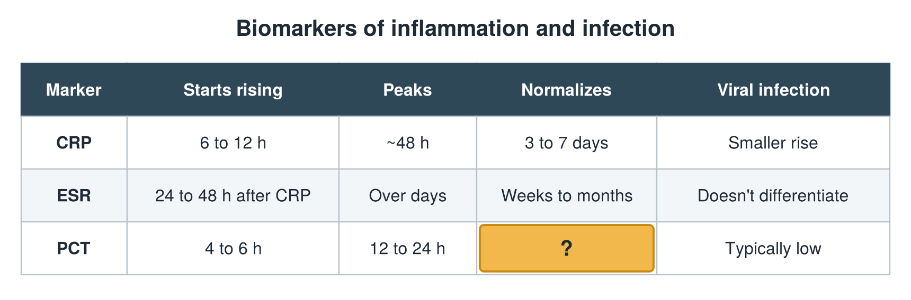

---
id    = "4d745329-60da-45ca-a5cb-9436b319c486"
model = "Basic"
tags  = ["phmd205c", "biomarkers-infection"]
---

## Front

Infection biomarkers: what is hidden?

## Back

Normalizes Falls fast

## Extra

Original diagram made for this deck.

Source: PHMD 205C, Biomarkers of Inflammation and Infection.
