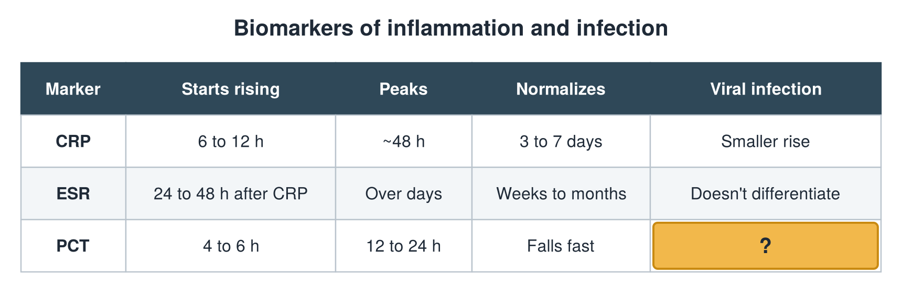

---
id    = "adde6119-dec6-4bd1-b4b9-b6f75b0cd018"
model = "Basic"
tags  = ["phmd205c", "biomarkers-infection"]
---

## Front

Infection biomarkers: what is hidden?

## Back

Viral infection Typically low

## Extra

Original diagram made for this deck.

Source: PHMD 205C, Biomarkers of Inflammation and Infection.
