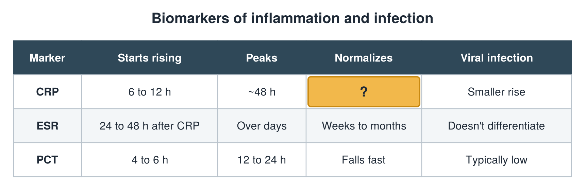

---
id    = "58bbadc1-494e-4baf-a1c0-827d80938957"
model = "Basic"
tags  = ["phmd205c", "biomarkers-infection"]
---

## Front

Infection biomarkers: what is hidden?

## Back

Normalizes 3 to 7 days

## Extra

Original diagram made for this deck.

Source: PHMD 205C, Biomarkers of Inflammation and Infection.
