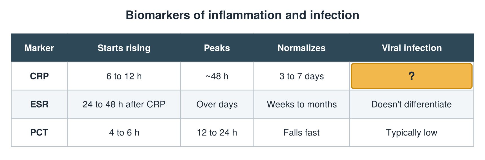
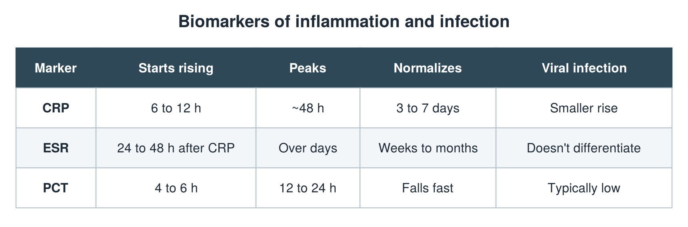

---
id    = "1f643e36-1bd0-4473-b273-80239cdc3279"
model = "Basic"
tags  = ["phmd205c", "biomarkers-infection"]
---

## Front

Infection biomarkers: what is hidden?

## Back

Viral infection Smaller rise

## Extra

Original diagram made for this deck.

Source: PHMD 205C, Biomarkers of Inflammation and Infection.
