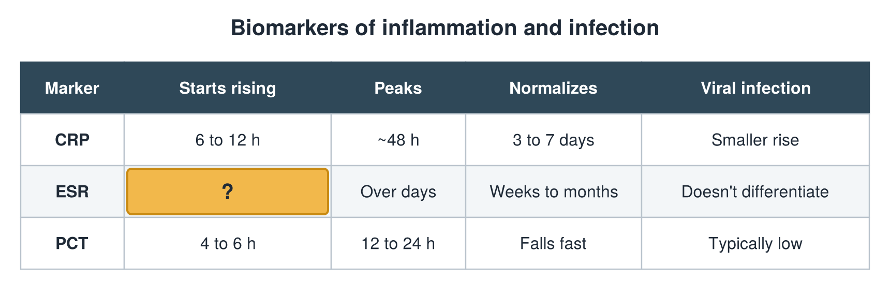

---
id    = "eb4637b0-f226-4d4b-91b6-21d9e4cb9515"
model = "Basic"
tags  = ["phmd205c", "biomarkers-infection"]
---

## Front

Infection biomarkers: what is hidden?

## Back

Starts rising 24 to 48 h after CRP

## Extra

Original diagram made for this deck.

Source: PHMD 205C, Biomarkers of Inflammation and Infection.
